<div align="center">


<a href="https://github.com/KrithinP"></a>


<a href="https://www.linkedin.com/in/krithinpoola/"></a>
<a href="mailto:f20251464@hyderabad.bits-pilani.ac.in"></a>
<a href="https://github.com/KrithinP"></a>


</div>

---

## About

I build autonomy stacks: the software that takes a robot from teleoperated to working it out for itself.

- **Perception and machine learning.** At Apollyon Dynamics I lead the EO + IR fusion perception stack for an autonomous UAV, training RGB–thermal detection models aimed at real-time inference on NVIDIA Jetson edge hardware.
- **Robotics software.** I lead the arm and autonomy division of Project Vanguard, the BITS Pilani Hyderabad Mars rover team, where the manipulation and navigation stacks are written and validated in simulation before the hardware exists.
- **Full-stack delivery.** I designed and shipped [poola.edu.in](https://poola.edu.in) end to end, along with a visitor-management mobile app, as sole designer and developer.
- **Engineering mindset.** Simulation and hardware expose identical interfaces, experiments are logged with the ones that failed, and every mistake goes into a written record with its root cause.

**Open to**

- Research collaborations in robot perception, manipulation and navigation
- Open-source robotics work in the ROS 2 ecosystem
- Conversations about sim-to-real transfer, edge inference and autonomy

---

## Tech Stack

**Languages**


**Robotics & Autonomy**


**Machine Learning & Edge AI**


**Frontend**


**Backend & Databases**


**Embedded & Hardware**


**DevOps & Tooling**


---

## AI / ML Expertise

| Domain | Proficiency | Details |
|:---|:---|:---|
| Multi-modal perception | Core | RGB–thermal (EO + IR) fusion detection: two-stream backbones, fusion operators and controlled modality-degradation studies |
| Object detection and tracking | Core | YOLOv8 and YOLOX pipelines from annotation and training through post-processing |
| Simulation and digital twins | Core | Isaac Sim and Isaac Lab, Gazebo, PX4 and ArduPilot software-in-the-loop |
| Edge inference | Applied | TensorRT optimisation targeting NVIDIA Jetson Orin NX and Nano within latency and power budgets |
| Visual localisation | Applied | GPS-denied position fixing by matching camera imagery against georeferenced maps, validated in SITL |
| SLAM and navigation | Applied | SLAM mapping and localisation, Nav2 planning, custom terrain-aware costmaps |
| Motion planning and manipulation | Applied | MoveIt 2 collision-aware planning, inverse kinematics and `ros2_control` for a 6-DoF arm |
| AI tooling and agents | Applied | Claude Code and the Claude Agent SDK: agents, MCP servers and custom skills |
| Reinforcement learning | Developing | Training manipulation policies in Isaac Lab |

<sub>Core: daily work · Applied: shipped in projects · Developing: actively learning</sub>

---

## Featured Projects

<details open>
<summary><b>Vanguard Arm</b> · Manipulation autonomy for a Mars rover's 6-DoF arm</summary>
<br/>

The complete software stack for a rover-mounted manipulator, built simulation-first for Project Vanguard: teleoperation with assistive autonomy for competition, growing into autonomous panel servicing.

| Aspect | Details |
|:---|:---|
| **Stack** | ROS 2 Humble · MoveIt 2 · `ros2_control` · BehaviorTree.CPP · NVIDIA Isaac Sim · CycloneDDS |
| **Scale** | 6-DoF arm with a task layer of six reusable skills that cover the manipulation tasks of IRC, ARC, ERC and URC |
| **Performance** | 60 Hz joint-state bridge to the digital twin; the first autonomous button press was verified by the button's own joint state, about 8 mm of travel |
| **Safeguards** | Collision-aware planning, joint-limit experiments distilled into safety design rules, every skill validated in simulation first |
| **Impact** | One unmodified trajectory client drives mock hardware and the Isaac Sim twin, so the software is ready before the arm is |
| **Repository** | [KrithinP/vanguard-arm](https://github.com/KrithinP/vanguard-arm) |

Simulation and hardware expose identical ROS 2 interfaces, which makes the physical arm one more backend for code that already runs. The project is documented in a LaTeX engineering book covering the theory, worked kinematics and every mistake with its root cause.

</details>

<details>
<summary><b>Vanguard Inductions 2026</b> · A mission-based robotics curriculum and recruitment programme</summary>
<br/>

The induction programme for the autonomous subsystem of the BITS Pilani Hyderabad Mars rover team, written to take people with no robotics background to a working autonomy task.

| Aspect | Details |
|:---|:---|
| **Stack** | ROS 2 Jazzy · Gazebo · Docker · GitHub Actions · Python |
| **Scale** | Four mission tasks, a handbook that starts from the terminal, and onboarding for Windows, macOS and Linux |
| **Performance** | Zero-install environment so beginners start immediately; submissions are checked automatically before human review |
| **Safeguards** | Graded on understanding rather than completion, with a code walkthrough closing each round |
| **Impact** | The division's recruitment programme for two groups: returning second-years and first-years new to robotics |
| **Repository** | [KrithinP/vanguard-inductions-2026](https://github.com/KrithinP/vanguard-inductions-2026) |

Support thins out deliberately from task to task: the first hands over a working example, the last only describes the problem.

</details>

<details>
<summary><b>PRISM</b> · A controlled study of RGB–thermal fusion for pedestrian detection</summary>
<br/>

A validation-first architecture study on the KAIST multispectral benchmark, comparing unimodal baselines with early, middle and late fusion under controlled modality degradation.

| Aspect | Details |
|:---|:---|
| **Stack** | PyTorch · YOLOX-S-derived two-stream detector · uv · Make |
| **Scale** | 7,601 training pairs and 2,252 test pairs; twelve fusion operators and controls; a five-seed validation matrix |
| **Performance** | Primary metric is log-average miss rate on the Reasonable-All subset; final numbers are withheld until the corrected run completes |
| **Safeguards** | Test-set release firewall, hashed manifests and attempt-level provenance for every run |
| **Impact** | A reproducible protocol for answering which fusion mechanism actually helps, and when |
| **Repository** | [KrithinP/prism](https://github.com/KrithinP/prism) |

Model selection never touches the test set: winners are frozen on sequence-disjoint validation splits before the next block of experiments starts.

</details>

<details>
<summary><b>HELIOS</b> · A Linux control panel for Acer Predator laptops</summary>
<br/>

Thermal profiles, fan curves, keyboard lighting, battery limits and live telemetry, built because the existing tooling had a bug that made profile selection unusable.

| Aspect | Details |
|:---|:---|
| **Stack** | Python standard library · GTK 3 + WebKit2 · systemd · static HTML, CSS and JavaScript |
| **Scale** | About 1,000 lines of dependency-free daemon code and a 66-line window |
| **Performance** | Zero writes in 60 seconds of idle, against 16 writes every 20 seconds in the tool it replaces; verified by a 58-check stress suite |
| **Safeguards** | The root daemon binds to localhost only, the interface runs unprivileged, and redundant writes are dropped server-side |
| **Impact** | An architecture in which reads can never cause writes, so the bug class is ruled out rather than patched |
| **Repository** | [KrithinP/helios](https://github.com/KrithinP/helios) |

Every write is counted and exposed through the API, which turns the no-write-loop guarantee into something tests can assert.

</details>

<details>
<summary><b>Mars Rover Autonomy</b> · Perception, mapping and planning in simulation</summary>
<br/>

A ROS 2 and Gazebo simulation of the team's rover, driven through a SLAM and Nav2 autonomy stack with YOLO-based detection of navigation cues.

| Aspect | Details |
|:---|:---|
| **Stack** | ROS 2 · Gazebo · SLAM · Nav2 · YOLO · URDF · RViz |
| **Scale** | A URDF rover with depth-camera input in a custom Martian terrain world |
| **Performance** | Detection, mapping, localisation and path planning exercised end to end, with live visualisation in RViz |
| **Safeguards** | Obstacle avoidance through Nav2, tested in a simulated Martian terrain world |
| **Impact** | The base for ongoing research into terrain-aware costmaps built from NASA Mars surface data |
| **Repository** | [KrithinP/mars_rover](https://github.com/KrithinP/mars_rover) · [KrithinP/mars_sim_env](https://github.com/KrithinP/mars_sim_env) |

</details>

<details>
<summary><b>Poola School Website</b> · A school website designed and built from scratch</summary>
<br/>

A replacement for an ageing Joomla site, designed and developed single-handedly during a summer internship.

| Aspect | Details |
|:---|:---|
| **Stack** | Astro · Tailwind CSS · PHP · MySQL |
| **Scale** | A full school site with a custom component set and a searchable library catalogue |
| **Performance** | Statically built pages with site-wide search and dark mode |
| **Safeguards** | Admissions enquiries handled server-side through a PHP and MySQL API, with credentials kept out of the repository |
| **Impact** | Live for the school, in English and Kannada |
| **Repository** | Private · live at [poola.edu.in](https://poola.edu.in) |

</details>

<details>
<summary><b>Poola Pass</b> · Visitor management for a school campus</summary>
<br/>

A visitor-management mobile app built for the school, with separate roles for guards and administrators.

| Aspect | Details |
|:---|:---|
| **Stack** | React Native · Expo · TypeScript · PHP · MySQL |
| **Scale** | Guard and admin roles, QR appointment passes, and camera and signature capture |
| **Performance** | Push notifications and a live approvals dashboard |
| **Safeguards** | Role-separated access for guards and administrators |
| **Impact** | Built for Poola School's visitor management |
| **Repository** | Private |

</details>

---

## Experience

### Machine Learning & Robotics Intern · [Apollyon Dynamics](https://github.com/apollyondynamics)

`January 2026 – Present` · Hyderabad, India

A deep-tech defence startup incubated at BITS Pilani Hyderabad, building high-speed autonomous UAVs.

- Lead the EO + IR fusion perception stack, training RGB–thermal detection models for real-time inference on NVIDIA Jetson edge hardware within fixed latency and power budgets.
- Built and ran software-in-the-loop simulation with PX4, ROS 2 and Gazebo to validate guidance, control and mission autonomy before flight.
- Developed a GPS-denied position fix for a fixed-wing UAV, matching downward camera imagery against a georeferenced map and feeding the estimate back over MAVLink.
- Contributed propulsion sizing to Ahuti Mk II, certified at 498 km/h and recognised by the India Book of Records as India's fastest multirotor UAV.
- Supported hardware–software integration and field trials, and maintained the technical documentation.

`ROS 2` `PX4` `ArduPilot` `Gazebo` `MAVLink` `PyTorch` `TensorRT` `NVIDIA Jetson` `MATLAB & Simulink`

### Autonomy Division Lead · [Project Vanguard](https://github.com/bphcvanguard)

`June 2026 – Present` · Team member since September 2025 · BITS Pilani, Hyderabad

The Mars rover team of BITS Pilani Hyderabad.

- Lead the arm and autonomy division: formed the teams, assigned ownership and set milestones so the software was ready before the hardware arrived.
- Co-developed the rover's autonomy stack end to end, with YOLO-based detection, SLAM, and Nav2 for path planning and obstacle avoidance.
- Built and simulated the 6-DoF manipulator in Isaac Sim and Isaac Lab, with MoveIt 2 for collision-aware motion planning.
- Researching terrain-aware navigation with a custom costmap built from NASA Mars surface data, and writing up the results as a paper.
- Designed, wrote and ran the division's induction programme, and now mentor new members through their first robotics software projects.
- Integrated sensors and motor drivers with Arduino and ESP32, and designing subsystem PCBs in KiCad.

`ROS 2` `MoveIt 2` `Nav2` `SLAM` `Isaac Sim` `Isaac Lab` `YOLO` `KiCad` `Technical Leadership`

### Summer Intern · Poola School

`May 2026 – July 2026` · Bangalore, India

- Designed and built the school's website from scratch, with a searchable library catalogue, bilingual English and Kannada pages, and a PHP and MySQL backend for admissions enquiries.
- Built Poola Pass, a visitor-management mobile app with guard and admin roles, QR appointment passes and a live approvals dashboard.
- Introduced AI tooling into internal workflows to cut manual effort on recurring administrative tasks, including a teacher schedule and timetable system.

`Astro` `PHP` `MySQL` `React Native` `Expo` `AI Tooling`

---

## Achievements

<div align="center">

| Recognition | Details |
|:---|:---|
| India Book of Records | Part of the Apollyon Dynamics team behind Ahuti Mk II, certified at 498 km/h as India's fastest multirotor UAV |
| Autonomy Division Lead | Leading the arm and autonomy division of the BITS Pilani Hyderabad Mars rover team |
| Induction Programme Author | Designed and ran Project Vanguard's 2026 autonomy induction, published as an open curriculum |
| Research in Progress | Terrain-aware rover navigation using NASA Mars surface data, being written up as a paper |
| ICSE Grade 10 | 97.8% in the board examinations |

</div>

---

## GitHub Analytics

<div align="center">





</div>

---

## GitHub Trophies

<div align="center">


</div>

---

## Contribution Activity

<div align="center">



</div>

---

## Contribution Snake

<div align="center">

<picture>
  <source media="(prefers-color-scheme: dark)" srcset="./profile/snake-dark.svg" />
  <source media="(prefers-color-scheme: light)" srcset="./profile/snake-light.svg" />
  
</picture>

</div>

---

## Current Focus

```yaml
learning:
  - Reinforcement learning for manipulation in Isaac Lab
  - PCB design in KiCad for rover subsystem boards

building:
  - RGB-thermal fusion perception for real-time edge inference
  - Manipulation autonomy for a 6-DoF rover arm
  - Terrain-aware costmaps for rover navigation

exploring:
  - Perception under sensor degradation
  - Sim-to-real transfer for manipulation
  - Edge inference on real power budgets

open_to:
  - Research collaborations in robotics and perception
  - Open-source work in the ROS 2 ecosystem
```

---

## Connect

<div align="center">

<a href="mailto:f20251464@hyderabad.bits-pilani.ac.in"></a>
<a href="https://www.linkedin.com/in/krithinpoola/"></a>
<a href="https://github.com/KrithinP"></a>
<a href="https://github.com/bphcvanguard"></a>

</div>

---

<div align="center">

<i>"Most engineering time is lost to things somebody figured out once and never wrote down."</i>


</div>
